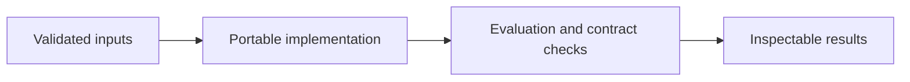

# HR Relational Database and Access Control

**Feras Elghandour** · Technical case study

Represent employee history, organizational structure, and salary records in a normalized relational database with deliberate access boundaries.

## Implementation

A seven-table relational core with integrity constraints and a salary-free directory view, plus separate PostgreSQL role setup.



## Completed study

The schema defines seven related tables and isolates salary records from the non-manager reporting role. The SQL source is included with execution order and permission checks; no real employee records are distributed.

These historical figures describe the completed study. This refactored standalone implementation has separate validation and has not been used to recertify the historical benchmark. The public release contains the portable core and focused tests.

## Run locally

Python 3.11 or later.

```sh
python -m venv .venv
source .venv/bin/activate
python -m pip install -r requirements.txt
python smoke_test.py
python smoke_test.py
```

Prepare your own inputs as described in [DATA.md](DATA.md). Tests use generated fixtures and do not need credentials or provider calls. [VALIDATION.md](VALIDATION.md) records their scope.

## Practical relevance and limitations

Run only in a dedicated development database. This source edition has not been certified against an operational HR system or audited production permissions. Existing installations need migrations rather than re-running initial DDL.

This edition makes the core behavior reusable and inspectable. Historical metrics and synthetic contract tests provide different kinds of evidence; neither establishes client deployment or commercial impact.
