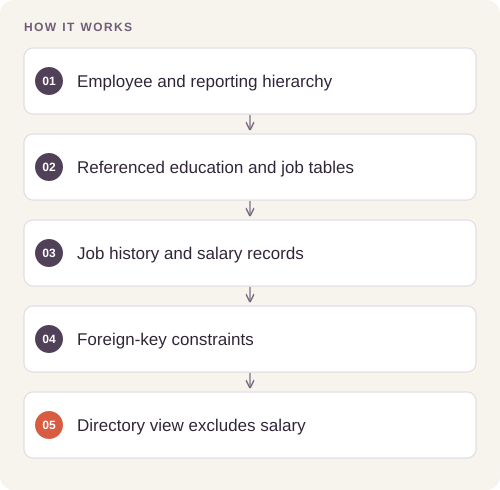

# HR Relational Database and Access Control

Represent employee history, organizational structure, and salary records in a normalized relational database with deliberate access boundaries.

## Implementation

A seven-table relational core with integrity constraints and a salary-free directory view, plus separate PostgreSQL role setup.




## Verify database behavior

The portable SQLite checks are retained. A rollback-only PostgreSQL integration script now checks the reporting role, salary exclusion and actual directory query in a disposable database.

[Commands, artifacts and benchmark scope](BENCHMARKS.md) · [Versioned profiles](reproduction.json)


## Try a small example

A small offline fixture exercises the public implementation. It demonstrates the behavior shown below; it does not replace the historical dataset, benchmark or production validation.

After the local setup below, run from the repository root:

```sh
python examples/quickstart.py
```

The [example source](examples/quickstart.py), [captured output](examples/expected-output.txt) and [execution record](examples/environment.json) keep this demonstration inspectable. Floating-point values may vary with library versions.

Observed output from this run:

```text
{
  "directory_columns": [
    "employee_id",
    "display_name",
    "email",
    "hired_on",
    "manager_name"
  ],
  "directory_rows": [
    [
      1,
      "Example employee",
      "example@example.invalid",
      "2024-01-01",
      null
    ]
  ]
}
```

## Completed study

The schema defines seven related tables and isolates salary records from the non-manager reporting role. The SQL source is included with execution order and permission checks; no real employee records are distributed.

These historical figures describe the completed study. This refactored standalone implementation has separate validation and has not been used to recertify the historical benchmark. The public release contains the portable core and focused tests.

## Run locally

Python 3.11 or later.

```sh
python -m venv .venv
source .venv/bin/activate
python -m pip install -r requirements.txt
python smoke_test.py
```

Prepare your own inputs as described in [DATA.md](DATA.md). Tests use generated fixtures and do not need credentials or provider calls. [VALIDATION.md](VALIDATION.md) records their scope.

## Practical relevance and limitations

Run only in a dedicated development database. This source edition has not been certified against an operational HR system or audited production permissions. Existing installations need migrations rather than re-running initial DDL.

## Reuse

The original contributions listed in [LICENSING.md](LICENSING.md) are available under [MIT](LICENSE). This scoped grant preserves upstream notices and separate dataset, simulator, notebook and checkpoint terms.
